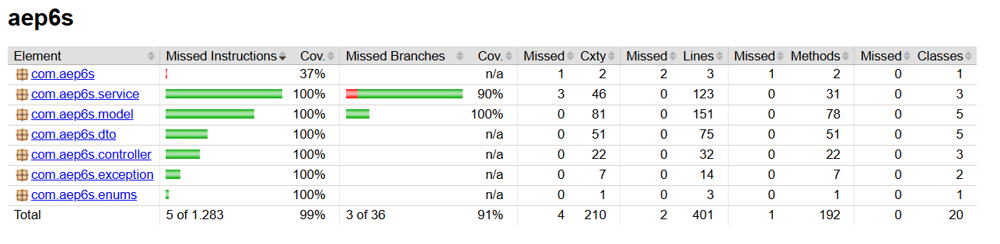

# AdotaPet 
**Onde histórias encontram um novo começo**

## Sobre o projeto

O **AdotaPet** é uma API REST desenvolvida para apoiar o cadastro e o
gerenciamento de animais disponíveis para adoção. A aplicação organiza
informações dos animais, dos possíveis adotantes e dos registros de
adoção.

Na segunda versão, a estrutura foi ampliada: além da coleção de animais,
foram implementadas coleções próprias para adotantes e adoções. Também
foram adicionados subdocumentos para armazenar endereços e informações
de vacinação, além de funcionalidades relacionadas à castração.

O projeto é uma aplicação acadêmica desenvolvida com Java e Spring Boot
e utiliza o MongoDB para persistência dos dados. Sua proposta está
relacionada ao **ODS 11 — Cidades e Comunidades Sustentáveis**,
pois contribui para uma organização mais eficiente de informações 
relacionadas ao bem-estar animal e à adoção responsável.

## Tecnologias utilizadas

- Java 17
- Spring Boot 3 (Web, Data MongoDB, Validation)
- MongoDB
- Maven
- JUnit 5 e Mockito 
- JaCoCo 

## Arquitetura do projeto

A aplicação utiliza uma arquitetura em camadas. O controlador recebe
as requisições HTTP, o serviço executa as regras de negócio e o 
repositório realiza a comunicação com o MongoDB.

-   **Model:** representa os dados dos animais armazenados no MongoDB.
-   **DTO:** representa os dados recebidos nas requisições.
-   **Repository:** realiza a comunicação com o MongoDB.
-   **Service:** concentra as regras de negócio.
-   **Controller:** disponibiliza os endpoints da API.
-   **Exception:** trata erros e respostas de validação.
-   **Enum:** define os status de adoção.

``` text
src
├── main
│   ├── java
│   │   └── com.aep6s
│   │       ├── controller
│   │       ├── dto
│   │       ├── enums
│   │       ├── exception
│   │       ├── model
│   │       ├── repository
│   │       └── service
│   └── resources
│       └── application.properties
│
└── test
    └── java
        └── com.aep6s
            ├── controller
            ├── model
            └── service
```
## Banco de dados

A aplicação utiliza o **MongoDB** (NoSQL), banco `adotapet`, com **múltiplas
coleções relacionadas** e **documentos complexos** (listas de subdocumentos).

| Coleção | Conteúdo | Tipo de dado |
|---|---|---|
| `animais` | dados do animal, status e **lista embutida de vacinas** | documento complexo |
| `adotantes` | dados do adotante e **lista embutida de endereços** | documento complexo |
| `adocoes` | vínculo entre um animal e um adotante (ids), data e observações | relacionamento entre coleções |


## Endpoints

### Animais — `/animais`

| Método | Rota | Descrição |
|---|---|---|
| POST   | `/animais` | Cadastrar animal (pode incluir `vacinas`) |
| GET    | `/animais` | Listar todos |
| GET    | `/animais/{id}` | Buscar por id |
| GET    | `/animais/status/{status}` | Listar por status (`DISPONIVEL`/`ADOTADO`) |
| GET    | `/animais/castrado/{true\|false}` | Listar animais castrados ou não castrados |
| PATCH  | `/animais/{id}/castracao` | Registrar a castração do animal (grava a data) |
| PUT    | `/animais/{id}` | Atualizar dados do animal |
| POST   | `/animais/{id}/vacinas` | Adicionar uma vacina ao animal |
| DELETE | `/animais/{id}` | Remover (não permitido se estiver adotado) |

### Adotantes — `/adotantes`

| Método | Rota | Descrição |
|---|---|---|
| POST   | `/adotantes` | Cadastrar adotante com endereços |
| GET    | `/adotantes` | Listar todos |
| GET    | `/adotantes/{id}` | Buscar por id |
| PUT    | `/adotantes/{id}` | Atualizar adotante |
| DELETE | `/adotantes/{id}` | Remover (não permitido se tiver adoções) |

### Adoções — `/adocoes`

| Método | Rota | Descrição |
|---|---|---|
| POST   | `/adocoes` | Registrar adoção (`animalId` + `adotanteId`) |
| GET    | `/adocoes` | Listar todas |
| GET    | `/adocoes/{id}` | Buscar por id |
| GET    | `/adocoes/adotante/{adotanteId}` | Listar adoções de um adotante |
| DELETE | `/adocoes/{id}` | Cancelar adoção (o animal volta a `DISPONIVEL`) |

## Exemplo de fluxo completo 

**1. POST `/animais`**

``` json
{
  "nome": "Thor",
  "especie": "Cachorro",
  "raca": "Golden Retriever",
  "idade": 3,
  "porte": "Grande",
  "sexo": "Macho",
  "descricao": "Cachorro dócil e brincalhão",
  "castrado": false,
  "vacinas": [
    { "nome": "V10", "dataAplicacao": "2026-08-15", "observacao": "Primeira dose" }
  ]
}
```

**2. POST `/adotantes`**

``` json
{
  "nome": "Maria Silva",
  "email": "maria@email.com",
  "telefone": "44999990000",
  "enderecos": [
    { "rua": "Rua A", "numero": "100", "cidade": "Maringá", "estado": "PR" }
  ]
}
```

**3. POST `/adocoes`** (use os ids retornados nos passos 1 e 2)

``` json
{
  "animalId": "id-do-animal",
  "adotanteId": "id-do-adotante",
  "observacoes": "Visita ao novo lar realizada"
}
```

Para registrar a castração depois, use `PATCH /animais/{id}/castracao`.

Após o passo 3 o animal passa para o status `ADOTADO`. Para desfazer,
use `DELETE /adocoes/{id}`.

## Regras de negócio

A aplicação possui regras para manter a consistência dos registros:

- Não permitir cadastro de adotantes com e-mails duplicados.
- Não permitir remover adotantes que possuam adoções registradas.
- Não permitir remover animais que estejam adotados.
- Não permitir registrar uma nova adoção para um animal já adotado.
- Verificar a existência do animal e do adotante antes de registrar uma adoção.
- Ao cancelar uma adoção, retornar o animal ao status disponível.
- Validar os dados obrigatórios e os formatos recebidos nas requisições.

## Testes automatizados

O projeto possui testes organizados em três grupos principais:

- **Models:** verificam o comportamento dos modelos e subdocumentos.
- **Services:** verificam as regras de negócio.
- **Controllers:** verificam os endpoints da API.

Para executar os testes no Windows:

```bash
mvnw.cmd clean verify
```

## Cobertura dos testes

Na versão atual da PoC, foram executados:

``` text
94 testes
0 falhas
0 erros
```

A cobertura total registrada no relatório JaCoCo é de aproximadamente
**99%**, ultrapassando o mínimo de 70% exigido. Como pode ser observado
na imagem abaixo.



O relatório também pode ser executado e encontrado **após a execução dos testes** em:

``` text
target/site/jacoco/index.html
```

## Como executar o projeto

### Pré-requisitos

Instale:

-   Java 17;
-   MongoDB local;

### 1. Clonar o repositório

``` bash
git clone https://github.com/VihSouza06/AEP6S_AdotaPet.git
```


### 2. Configurar o MongoDB

A aplicação utiliza:

``` text
mongodb://localhost:27017/adotapet
```

Certifique-se de que o MongoDB esteja em execução na porta `27017`.

### 3. Executar a aplicação

No Windows:

``` bash
mvnw.cmd spring-boot:run
```

A API será executada na porta configurada no arquivo
`application.properties`.

## Documentação complementar

- [Documentação Técnica](docs/documentacao-tecnica.md)
- [Metodologia Kanban](docs/metodologia-kanban.md)
- [Quadro de atividades — GitHub Projects](https://github.com/users/VihSouza06/projects/1/views/1)

------------------------------------------------------------------------

**Projeto: AdotaPet \| AEP - Engenharia de Software 6S \| 2026.2**
